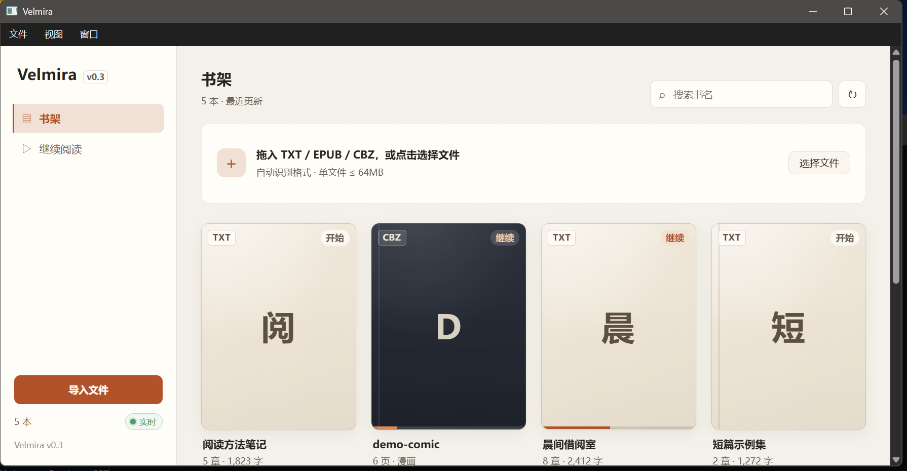

# Velmira

本地优先的小说 / 漫画阅读器。导入 TXT、EPUB、CBZ 即读：分页阅读、书签、注释高亮、全文检索、分段选片，书库实时同步。

> 版本 v0.5.1 · Android 打开即用的本机书库与手机 AI · 多设备离线阅读与可选同步 · AI 功能使用所配置的 API · 零第三方前端依赖
> 仓库：https://github.com/sakucyber/Velmira

## 当前阅读器实现

当前版本使用 web/ui/paging.js 中的自研原生分页内核（CSS 多列 + translateX），前端是零依赖 ES modules 和原生 CSS，不需要 Vite、TypeScript 或 foliate-js 子模块。章节、段落和字符偏移组成稳定定位，供进度、书签和批注复用。早期 foliate-js 设计记录已从运行时说明中移除；第三方许可仍集中在 NOTICE.md。
## 内容政策

- 软件不内置任何书籍、角色或原文片段；书库内容完全由你导入的文件决定，首次启动是空书架，书库列表实时更新。
- 仓库只提供中性示例：samples/demo-text.txt（通用占位文本）与 samples/demo-comic.cbz（程序绘制的占位分镜），用于演示分页、高亮、漫画模式。
- 产品界面、文案与截图中不出现任何具体小说内容。

## 快速开始

~~~powershell
# 1) 安装后端依赖并起服务（Windows；Python 3.11+；无需 npm）
python -m pip install -r server/requirements.txt
powershell -NoProfile -ExecutionPolicy Bypass -File scripts/run.ps1
# → http://127.0.0.1:8765/

# 2) 把 TXT / EPUB / CBZ 拖进书库页即可；也可以先试 samples/ 里的示例

# 3) 一键回归
powershell -NoProfile -ExecutionPolicy Bypass -File scripts/verify.ps1
powershell -NoProfile -ExecutionPolicy Bypass -File scripts/verify_m1.ps1
~~~

## AI 漫画与模型设置

设置页集中管理模型库、文本/生图模型池、提示词、联网搜索、长期记忆和局域网访问。模型库保存供应商连接、能力、价格和适用任务；模型池卡片可拖动排序，支持顺序降级、轮询和随机分配。漫画设置直接使用模型池统一管理的连接和模型。联网搜索默认关闭，结果保留来源并只作为参考上下文；长期记忆可按全局、书籍和人物维护人格、梗知识及世界观。搜索密钥在本机设置卡片中直接显示，重新打开设置仍保留；其他连接只显示密钥是否已配置。

### 漫画生成流程

新增“整页分镜”：文本模型按剧情节点划分分页，逐页编排 1–7 格，预览并修改人物位置、动作、环境、对白和原文依据，再生成单人、双人互动或环境空镜。长章节可生成多页，每格保留对应原文位置，便于小说与漫画同步阅读。自动漫画可选择每页确认后出图。云端图像支持有序多参考图、并发和 RPM 限流；Agnes 使用 JSON generations 参考图接口。模型对照与限制见 [整页分镜验证](docs/STORYBOARDS-REPORT.md)。

阅读页提供手动、自动播放、语音朗读三种同步模式，支持暂停、继续与调速；每章生成 100–250 token 的连续性记忆。使用方式与验证范围见 [自动漫画与同步阅读](docs/MANGA-SYNC.md)。

“设置 → 漫画与画风设置”新增独立的文本与生图模型池：添加任意已保存连接、调整顺序、移除候选，选择按顺序降级、轮流或随机分配。失败、超时和无效输出会尝试备用模型；繁忙连接优先让给其他候选，故障模型按配置冷却。可设置温度、Token、超时及每连接限流，并查看最近24小时调用状态。详见 [模型降级与负载均衡](docs/MODEL-ROUTING.md)。

打开文字小说后，顶部的「自动漫画」开关会从当前章节起按顺序生成后续情节。在「漫画进度」中查看阶段、已完成页面和历史生成记录，也可暂停或继续。首次使用先在「设置 → 漫画与画风设置」的文本、生图模型池中添加连接并启用需要的模型（默认二次元风格，可使用 MOSS / ComfyUI）。

全书分析完成前 10 章后即可开始画漫画，剩余章节同时继续分析；不足 10 章则分析全书。每章分析完成后，按剧情选择分页和每页 1–7 格，由代码拼装提示词，带人物参考图出图并拼页。默认画风为日系二次元彩色漫画，包含二维线稿、动漫五官和赛璐璐阴影约束；默认排除真实摄影、皮肤毛孔与 3D 渲染，明确选择的其他画风和自定义提示词保留。出图前分镜编辑器会显示当前生效的人物形态、参考图缩略图和可用的已确认参考图，选择会写入生成快照并再次由后端校验。云端图像按配置并发，本机 ComfyUI 保持串行。如果当前阅读章节尚未分析到，会等待该章就绪。已完成内容和暂停位置保存在本机；开启状态会在软件重启后续跑。自动页为草稿，双人互动和环境空镜须复核，单人身份校验不通过的图片也保留待复核标记。已完成的本章漫画会显示在正文右侧，窄屏显示在正文下方。

单连接请求最多尝试 3 次（含首次）；开启模型池后，每轮按策略尝试候选，失败候选各尝试一次，冷却中的模型跳过，最多3轮后停止。设置中可先选“稳健 / 平衡 / 激进”预设，再展开高级参数；切换顺序或调度方式不会重置手动参数。自动漫画面板显示带时间的任务日志，失败后可打开“诊断与修复”，按密钥、权限、余额、限流、服务故障、超时或网络状态给出处理建议并继续任务；诊断不会再次调用外部模型。面板中的「漫画与画风设置」直接跳转到设置里的同名页；AI 面板将「AI 分析」与「人物卡」分为上下两行入口。

## 桌面应用（MyGo）

除了浏览器，Velmira 有 Windows 和 Linux 桌面端：用 [MyGo](https://github.com/egoist/mygo)（Go 桌面框架，MIT）把同一套界面装进系统 WebView 窗口，并由它启动/关闭本地 Python 后端。Windows 使用 WebView2，Linux 使用 WebKitGTK。

~~~powershell
# 构建（需要 Go 1.27+ 与 Python 3.11+；WebView2 由 Windows 10/11 提供）
powershell -NoProfile -ExecutionPolicy Bypass -File scripts/build-desktop.ps1

# 运行
desktop\Velmira.exe

# 自包含分发包（目标机无需安装 Python）
powershell -NoProfile -ExecutionPolicy Bypass -File scripts/build-desktop-bundle.ps1
~~~

Linux 原生桌面包使用系统 WebKitGTK，后端依赖安装到包内私有虚拟环境：

~~~bash
# 在 Linux 上执行，需要 Go 1.27+；目标机需要 GTK 3、WebKitGTK 4.1 和 Python 3
bash scripts/build-desktop-linux.sh
# 产物：dist/Velmira-desktop-v0.5.1-linux-amd64.tar.gz（或 arm64）
~~~

- 启动时并行初始化窗口和本地后端，健康检查通过后进入书架；退出时结束自己启动的后端进程树；
- 已有开发服务（8765）在跑时直接复用，方便调试；
- 1280×860 窗口、系统标题栏与窗口控件；桌面壳不显示原生菜单；
- `-screenshot` 参数可截图窗口后退出，用于验收与 CI。
- 桌面窗口禁用浏览器默认右键菜单；小说文件可拖到书架任意位置导入，拖入时显示提示。

细节见 [desktop/README.md](desktop/README.md)。

## Linux / 局域网访问

Linux 可以直接使用原生桌面包；也可以只运行同一套 Web 服务并用浏览器访问：

~~~bash
python3 -m pip install -r server/requirements.txt
bash scripts/run.sh
# → http://127.0.0.1:8765/
~~~

若需要 Android 连接电脑书库或局域网浏览器访问，请显式使用 bash scripts/run.sh --host 0.0.0.0，然后在本机“设置 → 局域网访问”点击“连接新设备”生成一次性二维码邀请并开启访问。邀请 5 分钟内有效且只能使用一次；更换主配对码才会撤销旧设备。远端必须先配对；连接、模型、搜索密钥和生成管理只允许本机。Android 本机书库无需此服务。

## 安卓客户端（通用 APK）

Android v0.5.1 APK 内置界面和仅监听手机 `127.0.0.1` 的本地书库服务，安装后打开即可使用，无需输入电脑地址。首次可选主题、字号、书架密度，也可跳过。点击「导入文件」导入手机中的 TXT / EPUB / CBZ，即可离线阅读、搜索，并保存进度、书签和批注。

书架与小说阅读器均提供手机 AI 工作台，可总结章节、整理人物与人格、生成六格分镜、问答和生图。手机通过 APK 内的 Java 代理直接请求配置的云端服务，无需电脑；模型降级顺序、轮询/最少并发负载均衡、RPM/并发限制、提示词、长期记忆和联网搜索均在设置中管理。

默认文本模型为 `gpt-6-luna`，默认生图为 `agnes-image-2.5-flash`，以 `agnes-image-2.1-flash` 和 `agnes-image-2.0-flash` 依次备用。APK 不嵌入密钥，模型池默认关闭；首次需在设置中填写厂商密钥并启用。新 AI 请求和联网搜索需要网络，结果与生成图片保存在手机。整本自动漫画任务链仍由电脑服务运行。

连接电脑是可选功能：需要时扫描设置中的二维码，或把连接链接分享给 Velmira；也保留地址与配对码回退路径。切换到电脑书库。本机书库与电脑书库分别保存，当前不会自动合并。

~~~powershell
# 构建（需要 Android SDK：cmdline-tools + build-tools 35 + platform android-34；可用 .toolchains/android/sdk）
powershell -NoProfile -ExecutionPolicy Bypass -File scripts/build-android.ps1
# 产物：dist/Velmira-universal.apk（内置本地书库与 Web 界面，纯 Java + WebView，无 ABI 拆分）
~~~

可选电脑连接：电脑用 `scripts/run.ps1 -BindAddress 0.0.0.0`（或 `desktop\Velmira.exe -bind 0.0.0.0`）启动服务，手机在连接电脑设置中填入 `http://<电脑局域网IP>:8765` 并配对。该模式可逐书下载远端书籍、离线阅读和同步记录，详见 [docs/ANDROID.md](docs/ANDROID.md)。

## 多设备与离线

Android 本机书库直接保存导入的文件与阅读记录，无需下载或同步；卸载应用或清除应用数据会删除本机书库。

连接电脑服务的客户端在「设置 → 离线与同步」逐书下载或清除本机副本、控制自动同步、立即同步、处理修改冲突；服务本机还可撤销已注册设备。每个浏览器、应用及服务地址分别保存自己的远端缓存，每台设备需单独下载。

- Android 本机导入内容可直接断网阅读；电脑连接模式及浏览器可读已下载正文和插图、搜索缓存章节、增删书签、编辑批注、保存阅读进度；远端待同步操作保存在 IndexedDB，重启仍保留。
- 连接同一电脑服务时，联网后同步进度、书签和批注。批注版本冲突会保留本机副本，用户选择后再提交；书籍文件按设备显式下载，不自动复制整库，也不会合并 Android 独立书库。
- Windows 可使用桌面端或浏览器；Linux 可使用原生桌面包，也可运行同一 Python 服务并使用浏览器；macOS 可运行同一 Python 服务并使用浏览器。浏览器离线启动需要 HTTPS 或 localhost，以及成功安装的 Service Worker；局域网 HTTP 推荐使用内置界面的 Android APK。
- 手机可独立请求已配置的云端文本、生图和搜索服务，整本自动漫画任务链由电脑服务运行。手机和电脑各自管理模型、凭据、记忆与 AI 历史；这些内容不参与跨设备同步。

平台条件、数据保留和验证方法见 [离线与同步说明](docs/OFFLINE-SYNC.md)。

## 能做什么

| 能力 | 说明 |
| --- | --- |
| TXT 导入 | 编码探测（UTF-8 / GB18030 / UTF-16）、书头清洗、章节切分、段落索引 |
| EPUB 导入 | container.xml → OPF → spine；正文段落、标题、插图在正文锚点、重复引用和图片-only spine；复杂 CSS 统一到阅读器排版 |
| CBZ 漫画导入 | 自然排序解压、按页阅读、/media immutable 缓存 |
| 分页阅读 | 键盘 / 点击区 / 触摸滑动；目录过滤；3 套主题、12–48 px 连续字号；进度精确恢复 |
| 书签 | 当前段一键加书签、抽屉列表、跳转、去重 |
| 注释高亮 | 选中文字 → 4 色高亮 / 写笔记 / 复制；笔记文字显示双下划线，鼠标悬停或电脑/手机点击直接查看批注；支持编辑、删除与切章 / 改字号后重建 |
| 全文检索 | FTS5 trigram（≥3 字 bm25 / 2 字 LIKE / 1 字兜底），命中可跳转并高亮 |
| 分段选片 | 段落窗口 + 7 特征打分 + 语料百分位，每章选 1 个高分片段（为后续漫改准备） |
| 书库实时同步 | SSE 推送 + 5 秒轮询兜底；导入新书后书架自动出现，保留滚动位置、不整页刷新 |
| 书架管理 | 书名与格式生成稳定配色封面；统一章节/页数与进度；标准/紧凑密度、格式/阅读状态筛选、排序；详情、重命名、移出与恢复 |
| 阅读设置 | 右上角齿轮集中管理主题、字号与快捷键说明；漫画提供主题与适页/适宽；偏好在本机保存 |

书架按 `/` 可聚焦书名搜索，支持一键清空。卡片的 `⋯` 打开详情；移出书架后，可在“状态 → 已移出”中恢复，也可重新导入同一文件恢复原书，正文、进度、书签、批注和 AI 数据都会保留。

阅读页底部保留页码和全书进度，快捷键说明移至“设置”。字号可拖动滑块或直接输入，精确到 0.1 px，支持恢复默认 19 px，并自动兼容旧版四档字号。`← / → / 空格 / T / F / B` 等操作继续有效；设置打开或正在输入时，翻页快捷键暂停。桌面侧抽屉与手机底部面板使用相同设置。

## 书库实时同步怎么工作

- 后端 GET /api/events：SSE 长连接，导入新书后推送 books_changed（revision / count），15 秒心跳保活
- 前端：书库页订阅事件流，收到后重新拉取列表并原地更新；事件流不可用时自动退化为 5 秒轮询
- 书架状态点：连接中 / 自动更新 / 定时更新 / 离线；导入与管理操作会更新列表，不监视电脑文件夹；离开书库即关闭连接
- 另提供 GET /api/events/status（revision / subscribers）便于排障

## 技术选型

| 决策 | 选择 | 理由 |
| --- | --- | --- |
| 阅读内核 | 自研分页内核（CSS 多列 + translateX） | 无 iframe / blob 累积，行为可预测 |
| 前端 | 原生 ES Module + 原生 CSS，零依赖零构建 | 设置面板按需加载，IndexedDB 保存本机副本，Service Worker 缓存界面 |
| 后端 | Python 3.11 + FastAPI + SQLite(WAL) | 单机 all-in-one，后续接 ComfyUI 同栈 |
| EPUB | 段落定位 + 安全资源引用 | 复杂 CSS/脚本不执行，保证批注坐标稳定 |
| CBZ | 单个 img 换 src，不预加载 | 漫画原图 2–4MB / 页，单图 + immutable 缓存 |
| 实时 | SSE + 轮询兜底 | 单用户单进程场景最轻；断线自动降级 |
| 桌面端 | MyGo（Go）+ 系统 WebView2 | 原生窗口与生命周期，复用同一 Web 前端；Go 壳 + Python 边车 |
| Android | Java 本地 HTTP / AI 代理 + SQLite + 系统 WebView | APK 内独立导入与离线阅读，手机直连已配置的云端 AI；电脑连接可选 |

## 目录

~~~text
desktop/                MyGo 桌面壳（Go）：窗口、后端进程管理
server/
  app/importer*.py      格式识别（magic）+ TXT / EPUB / CBZ 解析
  app/api/books.py      books / toc / chapters / progress / bookmarks
  app/api/pages.py      漫画分页 + /media（immutable 缓存）
  app/api/annotations.py 注释高亮 CRUD
  app/api/events.py     SSE 实时事件流（v0.3）
  app/api/segments.py   分段选片
  app/api/search.py     FTS5 检索
  app/core/events_bus.py 进程内广播器
web/
  ui/paging.js          分页内核 + 高亮渲染
  ui/reader.js          章节 / 书签 / 注释 / 滑动 / CBZ 委托
  ui/annotations.js     选区菜单、高亮菜单、笔记弹层
  ui/comic.js           CBZ 漫画模式（单 img）
  ui/panels.js          目录过滤 / 书签 / 笔记 / 搜索 / 片段抽屉
  ui/library.js         多格式导入 + 实时书库
  ui/library-tools.js   进度与封面规则、书籍详情与可恢复管理
samples/                中性示例（demo-text.txt / demo-comic.cbz）
tests/                  断言脚本、CDP 探针、验收报告
scripts/                run.ps1 / verify.ps1 / verify_m1.ps1
docs/                   架构、计划、契约、截图
~~~

## 实测数字（本机）

| 指标 | 实测 |
| --- | --- |
| TXT 导入（234 章 / 51.6 万字） | 27ms |
| EPUB 导入（234 章） | ~140ms |
| 前端 JS 总量 | 约 215.8KiB（14 个文件，未压缩；漫画与设置面板按需加载） |
| 前端 CSS 总量 | 约 69.5KiB（2 个文件，未压缩） |
| index.html | 12,813 B |
| 首屏请求 | 文本 9 / 漫画 10–11 |
| 单章 DOM | 不超过 256（含高亮）；漫画模式 94 |
| 翻页 | 0.075ms / 次（只改 transform）；漫画翻页 0–4ms |
| 检索 | 温查 8–11ms；冷查约 240ms（含建索引） |
| 书库实时 | 导入后事件推送 100ms 内，列表原地更新 |

## 已知限制

- EPUB 不执行脚本、外部资源或复杂 CSS；基础图片资源按受保护接口提供，复杂浮动布局和字体效果不会完全复刻；CBZ 不解析 ComicInfo.xml，标题用文件名
- 双页模式未做；触摸滑动已在 Android 12 真机与 Chromium 合成事件中验证
- SSE 为单进程内广播（uvicorn 单 worker 假设）；多 worker 部署时自动退化为轮询
- 单用户模型；局域网访问需要本机生成配对码，远端只开放阅读与批注白名单

## M2 / M3

1. 接入可配置文本 LLM → 真正的 scene 抽取与人物卡冻结（docs/ARCHITECTURE.md 模块 C/D）
2. ComfyUI / MOSS 出图 + 参考图注入 + 人脸校验已接入，真实 10 格中 8 格达到 0.55（[M3 报告](docs/M3-REPORT.md)）
3. AI 阅读助手（docs/AI-READER-ASSISTANT.md）

## M4 成页与 CBZ

七种拼页模板、Pillow 中文排版、可编辑旁白／对白、revision 冲突保护、软删除恢复和 CBZ 导出已经接入“漫画生成 → 拼页与导出”。导出的漫画会加入书架，并可从小说阅读页和漫画阅读页互相跳转。验证记录见 [M4 报告](docs/M4-REPORT.md)。

## 文档与证据

- docs/M0-PLAN.md · docs/M1-PLAN.md · docs/API-CONTRACT.md（v0.4）
- [AI 失败诊断与可恢复性](docs/AI-DIAGNOSTICS.md)（阶段/原因、分级探测、失败样本与诊断包）
- tests/REPORT.md · tests/REPORT-M1.md · [v0.4 验证记录](tests/REPORT-v0.4.md)
- [v0.4.0 本地交付说明](docs/RELEASE-v0.4.0.md)
- 截图：阅读器 · 笔记 · 目录 · 搜索 · 漫画 · 书库 · 移动端（docs/screenshots/）
