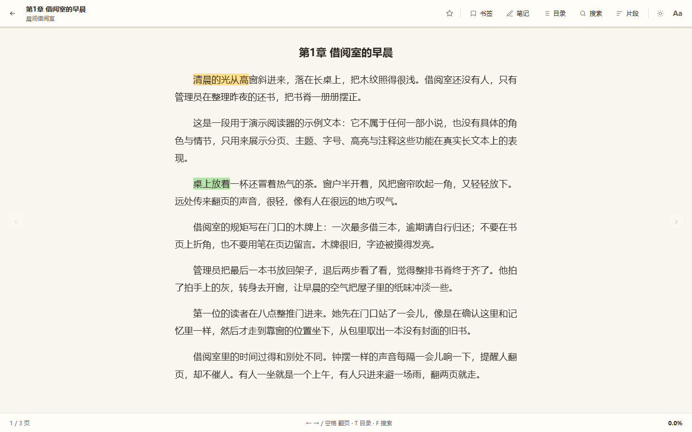
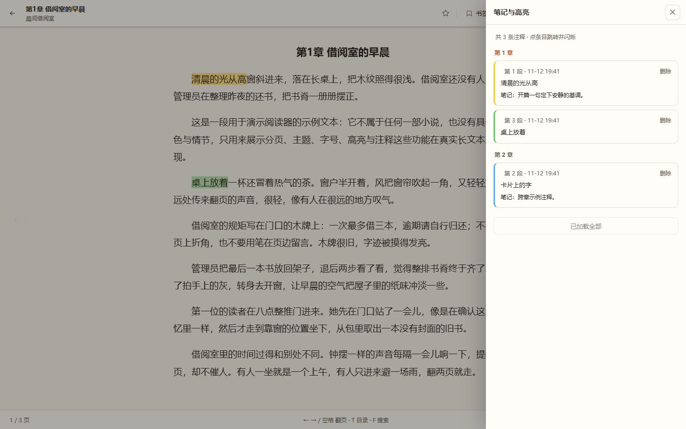

# Velmira

本地优先的小说 / 漫画阅读器。导入 TXT、EPUB、CBZ 即读：分页阅读、书签、注释高亮、全文检索、分段选片，书库实时同步。

> 版本 v0.3.0 · 纯本地运行 · 无需联网 · 零第三方前端依赖
> 仓库：https://github.com/sakucyber/Velmira

## 基于 foliate-js

本项目的阅读器方案基于 [foliate-js](https://github.com/johnfactotum/foliate-js)（MIT License，作者 John Factotum）：

- 阅读内核思路沿用其契约：合成 Book 对象、按 section 加载、基于 Locator 的定位与重排；
- 当前版本为控制体积与内存，用自研的最小分页内核实现同等阅读体验，并把对其 `open` / `relocate` / `sections` 契约的接入点保留为后续 EPUB/CBZ 集成路径；
- foliate-js 的版权与许可声明见 [NOTICE.md](NOTICE.md)。

## 内容政策

- 软件不内置任何书籍、角色或原文片段；书库内容完全由你导入的文件决定，首次启动是空书架，书库列表实时更新。
- 仓库只提供中性示例：samples/demo-text.txt（通用占位文本）与 samples/demo-comic.cbz（程序绘制的占位分镜），用于演示分页、高亮、漫画模式。
- 产品界面、文案与截图中不出现任何具体小说内容。

## 快速开始

~~~powershell
# 1) 起服务（Windows；Python 3.11 + 已装 fastapi/uvicorn/Pillow，无需 npm/pip 安装）
powershell -NoProfile -ExecutionPolicy Bypass -File scripts/run.ps1
# → http://127.0.0.1:8765/

# 2) 把 TXT / EPUB / CBZ 拖进书库页即可；也可以先试 samples/ 里的示例

# 3) 一键回归
powershell -NoProfile -ExecutionPolicy Bypass -File scripts/verify.ps1
powershell -NoProfile -ExecutionPolicy Bypass -File scripts/verify_m1.ps1
~~~

## 桌面应用（MyGo）

除了浏览器，Velmira 有原生桌面端：用 [MyGo](https://github.com/egoist/mygo)（Go 桌面框架，MIT）把同一套界面装进系统 WebView2 窗口，并由它启动/关闭本地 Python 后端。

~~~powershell
# 构建（需要 Go 1.27+ 与 Python 3.11+；WebView2 由 Windows 10/11 提供）
powershell -NoProfile -ExecutionPolicy Bypass -File scripts/build-desktop.ps1

# 运行
desktop\Velmira.exe
~~~

- 启动时自动在空闲端口拉起后端，健康检查通过后导航到界面；退出时结束后端进程树；
- 已有开发服务（8765）在跑时直接复用，方便调试；
- 原生菜单（文件 / 视图 / 窗口）、1280×860 窗口、系统标题栏与窗口控件；
- `-screenshot` 参数可截图窗口后退出，用于验收与 CI。

细节见 [desktop/README.md](desktop/README.md)。

## 能做什么

| 能力 | 说明 |
| --- | --- |
| TXT 导入 | 编码探测（UTF-8 / GB18030 / UTF-16）、书头清洗、章节切分、段落索引 |
| EPUB 导入 | container.xml → OPF → spine → 章节正文；与同源 TXT 的章 / 段 / 字数逐数值一致 |
| CBZ 漫画导入 | 自然排序解压、按页阅读、/media immutable 缓存 |
| 分页阅读 | 键盘 / 点击区 / 触摸滑动；目录过滤；3 套主题、4 档字号；进度精确恢复 |
| 书签 | 当前段一键加书签、抽屉列表、跳转、去重 |
| 注释高亮 | 选中文字 → 4 色高亮 / 写笔记 / 复制；点击可改色、改笔记、删除；切章 / 改字号后自动重建 |
| 全文检索 | FTS5 trigram（≥3 字 bm25 / 2 字 LIKE / 1 字兜底），命中可跳转并高亮 |
| 分段选片 | 段落窗口 + 7 特征打分 + 语料百分位，每章选 1 个高分片段（为后续漫改准备） |
| 书库实时同步 | SSE 推送 + 5 秒轮询兜底；导入新书后书架自动出现，保留滚动位置、不整页刷新 |

## 书库实时同步怎么工作

- 后端 GET /api/events：SSE 长连接，导入新书后推送 books_changed（revision / count），15 秒心跳保活
- 前端：书库页订阅事件流，收到后重新拉取列表并原地更新；事件流不可用时自动退化为 5 秒轮询
- 书架标题旁的状态点：连接中 / 实时 / 轮询 / 离线；离开书库即关闭连接
- 另提供 GET /api/events/status（revision / subscribers）便于排障

## 技术选型

| 决策 | 选择 | 理由 |
| --- | --- | --- |
| 阅读内核 | 自研分页内核（CSS 多列 + translateX） | 无 iframe / blob 累积，行为可预测 |
| 前端 | 原生 ES Module + 原生 CSS，零依赖零构建 | JS 约 120KB，首屏请求 9（文本）/ 10–11（漫画），无 node_modules |
| 后端 | Python 3.11 + FastAPI + SQLite(WAL) | 单机 all-in-one，后续接 ComfyUI 同栈 |
| EPUB | 只取文本、不渲染内嵌样式 | 与阅读器统一排版与高亮坐标，兼容性最好 |
| CBZ | 单个 img 换 src，不预加载 | 漫画原图 2–4MB / 页，单图 + immutable 缓存 |
| 实时 | SSE + 轮询兜底 | 单用户单进程场景最轻；断线自动降级 |
| 桌面端 | MyGo（Go）+ 系统 WebView2 | 原生窗口与生命周期，复用同一 Web 前端；Go 壳 + Python 边车 |

## 目录

~~~text
desktop/                MyGo 桌面壳（Go）：窗口、菜单、后端进程管理
server/
  app/importer*.py      格式识别（magic）+ TXT / EPUB / CBZ 解析
  app/api/books.py      books / toc / chapters / progress / bookmarks
  app/api/pages.py      漫画分页 + /media（immutable 缓存）
  app/api/annotations.py 注释高亮 CRUD
  app/api/events.py     SSE 实时事件流（v0.3）
  app/api/segments.py   分段选片
  app/api/search.py     FTS5 检索
  app/core/events_bus.py 进程内广播器
web/
  ui/paging.js          分页内核 + 高亮渲染
  ui/reader.js          章节 / 书签 / 注释 / 滑动 / CBZ 委托
  ui/annotations.js     选区菜单、高亮菜单、笔记弹层
  ui/comic.js           CBZ 漫画模式（单 img）
  ui/panels.js          目录过滤 / 书签 / 笔记 / 搜索 / 片段抽屉
  ui/library.js         多格式导入 + 实时书库
samples/                中性示例（demo-text.txt / demo-comic.cbz）
tests/                  断言脚本、CDP 探针、验收报告
scripts/                run.ps1 / verify.ps1 / verify_m1.ps1
docs/                   架构、计划、契约、截图
~~~

## 实测数字（本机）

| 指标 | 实测 |
| --- | --- |
| TXT 导入（234 章 / 51.6 万字） | 27ms |
| EPUB 导入（234 章） | ~140ms |
| 前端 JS 总量 | 约 119.5KB（预算 150KB） |
| 首屏请求 | 文本 9 / 漫画 10–11 |
| 单章 DOM | 不超过 256（含高亮）；漫画模式 94 |
| 翻页 | 0.075ms / 次（只改 transform）；漫画翻页 0–4ms |
| 检索 | 温查 8–11ms；冷查约 240ms（含建索引） |
| 书库实时 | 导入后事件推送 100ms 内，列表原地更新 |

## 已知限制

- EPUB 只取文本（不渲染内嵌图片 / 样式）；CBZ 不解析 ComicInfo.xml，标题用文件名
- 双页模式未做；触摸滑动仅在 Chromium 无头环境用合成事件验证
- SSE 为单进程内广播（uvicorn 单 worker 假设）；多 worker 部署时自动退化为轮询
- 无鉴权、无多用户，定位单机 / 局域网自用

## 下一步（M2）

1. 接入可配置文本 LLM → 真正的 scene 抽取与人物卡冻结（docs/ARCHITECTURE.md 模块 C/D）
2. ComfyUI / MOSS 出图 + 参考图注入 + 人脸校验（docs/TRANSFORM.md）
3. AI 阅读助手（docs/AI-READER-ASSISTANT.md）

## 文档与证据

- docs/M0-PLAN.md · docs/M1-PLAN.md · docs/API-CONTRACT.md（v0.3）
- tests/REPORT.md · tests/REPORT-M1.md
- 截图：阅读器 · 笔记 · 目录 · 搜索 · 漫画 · 书库 · 移动端（docs/screenshots/）
