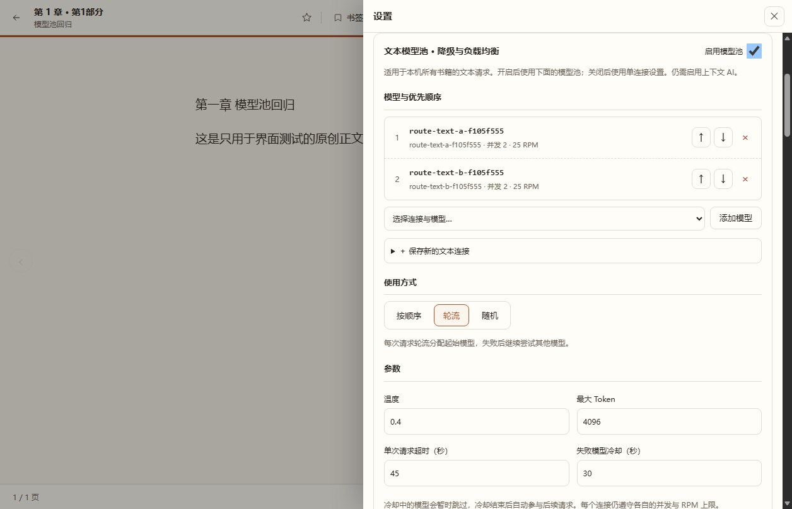

# 模型降级与负载均衡

在「设置 → 漫画与画风设置」中分别配置文本模型池、生图模型池。模型池适用于本机所有书籍；画风、尺寸、角色参考图仍由当前书籍决定。文本仍需启用「上下文 AI」，云端出图选择「生图模型池」后使用池中的连接；ComfyUI 和占位图使用独立后端。漫画设置不再重复填写文本或生图 API 地址、模型、密钥、限流与参考图接口。

## 配置方式

1. 从「选择连接与模型」添加候选。不同站点上的同名模型可以同时添加。
2. 用 ↑ / ↓ 设置优先级，用 × 移除候选。每池最多20个，同一连接的同一模型不能重复。
3. 选择使用方式，打开「启用模型池」。模型池字段会自动保存，也保留“立即保存”按钮作为兜底。旧版单连接配置仍由后端兼容，新连接统一在模型库和模型池中管理。
4. 自定义备用模型时，展开「保存新的连接」，填写名称、API地址（含 `/v1` 等接口前缀）、密钥和模型名称。支持一次填写多个模型，以逗号或换行分隔。保存连接后再加入模型池。

### 策略预设

模型池提供三档策略预设，适合先选一个可解释的默认值，再按需展开高级参数：

- **稳健**：180 秒超时、120 秒故障冷却，温度 0.2，适合结构化分析和长上下文请求。
- **平衡**：120 秒超时、60 秒故障冷却，温度 0.4，适合日常使用。
- **激进**：60 秒超时、15 秒故障冷却，温度 0.7，适合快速草稿和高吞吐。

选择预设只会在保存时应用该预设的默认参数；同一次保存中手动填写的高级参数优先。之后修改模型顺序、策略或其他字段不会重置已有的高级参数。生成漫画也有对应的稳健/平衡/激进预设，分别控制图像超时、相似度阈值、最大重画次数和分镜复核。

设置导航按“阅读 / AI 引擎 / 扩展功能 / 系统与网络”折叠分组。客户端可读取 `GET /api/config/domains` 和 `GET /api/config/presets` 构建同一套导航与预设说明；这些接口只返回公开元数据，不包含连接密钥。

| 使用方式 | 分配规则 | 失败后的行为 |
| --- | --- | --- |
| 按顺序 | 每次从第1个可用候选开始 | 顺次尝试后面的候选 |
| 轮流 | 请求1从模型1开始，请求2从模型2开始，循环分配 | 从本次起点继续遍历其他候选 |
| 随机 | 每次将候选随机排序 | 按本次随机顺序尝试其他候选 |

轮流分配使用进程内锁，并发请求也会轮换起点。它按请求数量分配，不按模型速度或价格加权；随机模式也不保证短期数量相等。

## 参数和恢复

- 文本温度0–2，最大Token 256–32768（硬上限32768，超出会在本地直接拒绝）。默认6000；推理模型（名称含 reasoner/thinking/deepseek-r/o3/gpt-oss 等）建议16000以上。模型池的温度、最大 Token、超时与冷却对该池内所有文本任务统一生效；未启用模型池时使用任务自身的温度默认值。
- 文本连接可选填写 `reasoning_effort`（minimal/low/medium/high/max）；留空不下发，保持对其他 OpenAI 兼容服务的兼容。连接检测 `POST /api/ai/probe` 分级返回模型列表、最小对话、JSON 输出与原文引文四步结果，便于区分“能连上”和“能跑通分析”。
- 单次请求超时5–600秒，失败冷却0–3600秒。冷却为0时不跳过失败模型。超时或HTTP错误、空响应、无效JSON以及业务结构校验失败都会尝试下一个文本候选。
- 图像候选沿用相同提示词、尺寸和有序角色参考图，同时切换模型、地址、密钥和参考图接口模式。无效图片、尺寸超出保存范围或解码失败也会降级。不会丢弃参考图改成纯文生图。
- 每个连接保存并发1–8和RPM上限；RPM=0表示不限。到达容量上限时先尝试其他候选，不把繁忙当成模型故障；全部繁忙时有界等待，最长为池超时。一次池调用中，实际失败的候选最多请求一次，尚未发出网络请求的繁忙候选可以等容量后再试。
- 同一API地址的同类请求共享预算。同池同地址的限制不同时采用较小并发和较严格的非零RPM。图像队列最多同时处理8项工作，池开启后按各地址容量调度，所有书籍共享这些限制。
- 故障模型在冷却后重新参与后续请求；所有模型故障/冷却会明确报错，保留任务进度。原有外层最多3轮重试仍有界；不会无限重试。

超时代表本地停止等待，上游可能仍在运行；切换站点无法提供全局计费去重。生图为每个候选生成稳定的独立幂等键，供应商是否执行去重取决于其接口。重启后不确定的在途图像任务仍执行原有保护。

## 状态和保存

最近24小时状态显示逻辑请求数、实际模型调用数、失败调用数，以及每个候选的平均耗时、失败率、安全错误分类和当前冷却。一次请求从模型1降级到模型2，统计为1个请求、2次调用。统计持久化在本机 `model-routing.sqlite3`，只保留安全元数据，不存小说、提示词、模型响应或密钥；统计写入失败不会丢弃成功结果或触发重发。

配置保存在本机 `text-routing.json` / `image-routing.json`，模型池和连接字段修改后自动保存并使用 revision 防止多个窗口互相覆盖；连接密钥直接保存于本机配置，公开 API 与分发包不回显密钥。改变文本池会改变分析及分镜缓存标识。

调度、冷却和限流按当前后端进程共享，重启后重新计算；其他客户端或其他后端进程发出的请求不在此限流计数中。24小时统计保留，不因重启清零。

图像连接检测只读取各候选的模型列表，不产生图片，也不改变生成调用统计或冷却。实际的尺寸和参考图支持仍在生成时校验。

## 验证

2026-11-13：Python单元/集成测试共172项通过，其中模型池28项，覆盖跨连接凭据切换、9线程轮流分配、结构无效降级、有序双参考图、繁忙等待、冷却恢复、统计故障和配置冲突。故障测试使用临时数据与受控响应，不消耗真实模型调用。

源码服务和自包含桌面包均通过浏览器回归：两类池独立保存、三种策略、增删排序、刷新持久化、实际填写新增连接与密码清空，桌面和390px手机宽度无横向溢出、无JavaScript异常。

[手机布局](screenshots/model-routing-mobile.jpg)。截图中的模型名称为界面测试专用连接。
