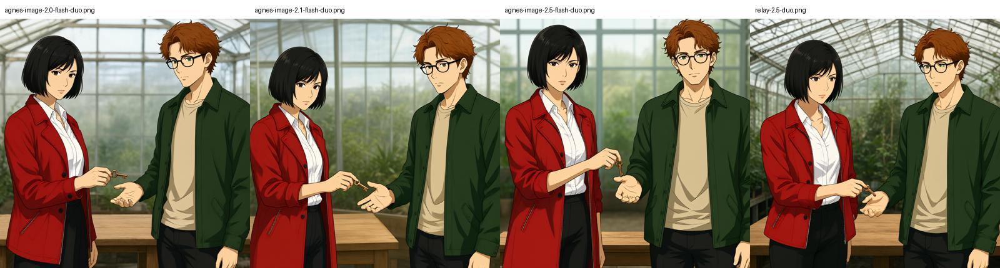

# 整页分镜与模型对照验证

日期：2026-11-13。测试使用原创短篇，不读取用户书库。连接配置和密钥只在本机数据目录保存，Windows 密钥使用 DPAPI 加密；不打包到分发文件。

## 实现

- 新的自动漫画流程每个场景一次请求生成整组结构化分镜，再由代码拼装提示词。四格场景原先需要一次分镜调用、每格两次总结/提示词调用，现在正常情况下仅需一次分镜调用；章节分析、缓存未命中与失败重试另计。
- 分镜包含画面类型、镜头、人物ID/位置/姿势、动作、环境、光线、情绪、旁白、对白、说话人和原文依据。空旁白允许保留无字画面；对白和依据必须在原文中出现，模型输出仍需人工检查语义。
- 单人镜头使用一张参考图，双人互动按顺序绑定两张参考图；环境空镜实际生图。现有 MOSS 工作流仅支持单参考图，双人会明确拒绝并提示选择多参考图图像 API。
- 漫画生成里的“整页分镜”提供预览、修改、调序、移除、整页/单格出图和历史方案。保存使用 revision 乐观锁，出图前检查原文、角色和参考图版本。
- 自动漫画可选择“每页先确认分镜再出图”。暂停和重启恢复已保存分镜，已开始出图的自动页禁止中途修改。旧版半页任务继续旧流程，下一页进入新流程。
- 双人身份、位置、参考图都参与过期检查；撤销第二个人物参考图也会使任务失效。双人/空镜不会用单人 ArcFace 分数冒充验收通过，统一保留待复核。自动生成仍是草稿。
- 云端图像队列支持每服务1–8并发，ComfyUI保持每服务串行；共享滑动60秒请求预算，每次网络重试也占用预算。文本接口同样有并发/RPM上限。限流在当前后端进程内生效，多进程或其他客户端的请求不在此计数中。
- 标准图像编辑使用 multipart `/images/edits`，双参考图以有序 `image[]` 上传。Agnes实测使用 JSON `/images/generations`，`image` 为有序 base64 data URI 数组。接口模式显式可选，不在失败后偷偷丢掉参考图降级成文生图。
- 本地 Bonsai 未以 `--structured-output` 启动，强制 JSON 请求返回400；关闭请求中的 `response_format` 后能工作，输出仍由程序严格校验。

## 文本模型

相同提示词、temperature=0.2、最终输出预算6000 tokens，三个样例分别覆盖双人递钥匙、无人车站、当前事件与回忆分离。每个模型每例一次请求；这是小样本功能验证，不是总体准确率基准。站点的模型名称和 token 使用量按接口返回记录，未验证第三方底层模型身份。

| 模型 | 最终结构校验 | 单次耗时 | 阅读输出后的观察 |
| --- | --- | --- | --- |
| 本地 bonsai2-27b | 3/3 | 9.3–11.8 秒 | 基本顺序正确；钟楼样例添加了“停止的时钟”，原文只说钟声停止，仍有视觉推断 |
| gpt-6-luna | 3/3 | 8.9–22.1 秒 | 本次复杂样例保留右手持表、左手开表和钟声停止后的顺序；未知光线留空，未让回忆人物出现在当前现场 |
| qwen3.8-27b | 3/3 | 3.2–5.7 秒 | 本次样例速度较快，复杂样例保持手部动作及人物缺席；适合作为批量处理候选 |
| gpt-oss-120b | 3/3 | 2.7–3.8 秒 | 较快，但钟楼样例自行补充傍晚和昏暗光线；格式合格不等于忠实原文 |

所有最终样例都通过了原文引文、人物集合和任务特定检查。前面的调试轮次也保留：3000 tokens 时 Qwen 的推理输出耗尽预算，导致JSON被截断或没有 content；其他模型曾出现镜头枚举、中英混合和人物回忆问题。提高预算与增加带错误原因的有界重试不能保证消除语义错误，因此保留分镜编辑入口。

建议：剧情优先选 Luna；批量速度优先试 Qwen；本地处理选 Bonsai。GPT-OSS保留可选，不凭一次格式通过作为默认质量结论。现有单格精修入口仍可使用原来的两阶段总结流程。

## 图像模型

使用两张原创成年角色参考图：黑短发、红外套女性与棕红卷发、眼镜、绿外套男性。四次对照使用完全相同的1024×1024请求，提示词仅按参考图序号定位人物，不重复发色/服装；检查左右位置、人物主要特征、铜钥匙交接、温室/木桌及无文字。

| 接口 / 模型 | 双参考图请求 | 单次耗时 |
| --- | --- | --- |
| Agnes / agnes-image-2.0-flash | 成功 | 27.4 秒 |
| Agnes / agnes-image-2.1-flash | 成功 | 39.4 秒 |
| Agnes / agnes-image-2.5-flash | 成功 | 20.9 秒 |
| 中转站 / agnes-image-2.5-flash | 成功 | 27.1 秒 |

视觉检查：四张均保留两人左右顺序、主要发型/服装/眼镜，画出递钥匙动作、温室和木桌；不能据此宣称长期角色一致性达到某个准确率。人物视线、手部细节和构图仍需按具体镜头复核。单样本速度受站点排队影响，当前默认选 Agnes 2.5，其他版本可以切换。

首次标准 `/images/edits` 测试在三个版本及中转站返回500/503，单参考图同样返回“no available server”；这不能证明模型不支持参考图。改用站点接受的 JSON generations 方式后全部成功。聊天接口明确提示图像模型须使用 images/generations。

原始结果与图片位于本机 `.tmp/model-eval/`，包含失败轮次。可用 `scripts/evaluate-models.py` 和 `scripts/evaluate-images.py` 重跑；需要本机已保存相应连接，运行会调用真实接口。

## 验证与限制

真实端到端测试：Luna分析一章原创温室短篇并一次编排5格，复用两张已目视检查的测试参考图，以自动草稿方式保留（未标记人工确认），Agnes 2.5生成4张双人镜头和1张环境空镜，自动拼成1200×1800页并后置中文对白。总计103.8秒，5张均一次生成；身份/剧情验收仍保留 `needs_review`，未伪造人脸分数或人工确认。[打开真实五格样张](screenshots/storyboard-live-page.jpg)。原始PNG保存在本机 `.tmp/model-eval/live-page.png`。

- Python单元/集成测试共144项，覆盖原有功能、单次文本调用、旧任务恢复与预览确认、双参考图协议、第二人物失效、修改冲突、跨书访问、限流和云端队列并发。
- 桌面1280px与手机390px浏览器回归完成了分镜编辑、保存升版、确认后出图、暂停恢复、日志、拼页和刷新恢复，无横向溢出、无JavaScript异常。
- 自包含桌面包后端另通过原有单格/参考图/身份升版、中文气泡、拼页和CBZ导出回归。分发目录为 `dist/Velmira-desktop-v0.4.0-storyboards/`。
- 最终桌面启动检查使用独立临时数据目录，WebView启动246毫秒、应用就绪760毫秒；这是本机单次测量。
- 模型对照是短篇样例；全书表现、各种画风、多页人物一致性仍需要更大规模评估。无声称跨模型等成本或整体准确率排名。
- 图像模型的 seed 支持因供应商而异；云端目前仅传其兼容参数，保存seed用于任务标识，不能保证云端逐像素复现。
