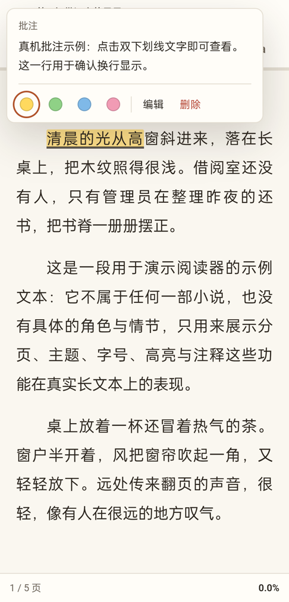

# Velmira v0.4.0 验证记录

验证日期：2026-11-12。所有自动化服务均使用隔离数据目录；现有用户书库未改动。截图与导入演示仅使用中性样例。

| 范围 | 结果 |
| --- | --- |
| M0 API 回归 | 41 项通过 |
| M1 API / 重启持久化 / CDP | 34 / 3 / 22 项通过 |
| Python 单元测试 | 37 项通过 |
| 批注、重复导入与整页拖放专项 | 14 项通过，源码服务和最终打包后端均验证 |
| Go 后端选择与数据目录测试 | 3 项通过，go vet 通过 |
| 前端检查 | 8 个 JS 文件语法通过，124.8KB，预算 150KB |
| Windows 自包含桌面端 | 打包、启动窗口、截图、退出与后端清理通过；从源码目录外启动且 PATH 不含 Python |
| Android APK | 构建、v2/v3 签名校验、真机安装通过 |

批注专项通过真实 API 创建中性书籍和批注，用 Edge CDP 检查双下划线、悬停和点击展示、换行与 HTML 文本安全、键盘操作、点击不翻页、编辑刷新后持久化、390×844 触摸与弹层边界、清空笔记恢复普通高亮，以及导入后返回书架可再次选择文件。浏览器未报告 JS 异常。

整页拖放使用 Chromium 的文件拖拽输入验证：文件拖到侧栏、搜索框、封面、标题空白处均导入并进入阅读；多次返回后仍能拖入。普通文字拖拽不触发导入提示，Escape 可收起文件拖入提示。

Windows 原生桌面窗口另通过实际右键输入确认：搜索框和书架区域均不弹出浏览器默认菜单。

真机为 OPPO PECM30，Android 12，1080×2400，WebView 151.0.7922.199。通过无线调试配对与端口反向映射连接隔离示例服务，覆盖：

- 连接、书架、实时书库同步、服务器不可用时的错误提示与重试按钮。
- TXT 阅读、批注文字双下划线、点击展示完整批注及换行，点击前后页码不变。
- 滑动翻页、书签与阅读进度持久化；返回键按阅读页 → 书架 → 设置运行。
- 系统文件选择器可见并导入 TXT / EPUB / CBZ；再次返回书架导入正常。
- EPUB 阅读与漫画翻页，漫画进度可从后端确认。

真机测试修复了文件选择器 MIME 过滤导致的空列表，以及成功导入后返回书架残留的导入锁。采集日志未见应用崩溃或 JS console error。

真机批注截图（中性样例，已裁去系统状态栏）：

边界：Android 7 的 Safe Browsing API 判断已修正并编译，尚无 Android 7 设备实测；其他机型、其他 WebView 版本尚未覆盖。CI 工作流已添加并本地核对配置，远端执行状态以 GitHub Actions 为准；本报告中的通过项均为本地执行结果。桌面包在本机实测，尚未覆盖全新 Windows 虚拟机。

复现：`scripts/verify_m1.ps1`、`scripts/verify.ps1`、`go test ./...`（desktop 目录）；启动隔离服务后运行 `node tests/cdp_annotations.mjs --base http://127.0.0.1:<端口>`。

## 2026-11-13 书架管理与阅读设置

- Python 单元测试：46 项通过，其中新增 5 项覆盖书名校验、旧数据库幂等升级、移出恢复、相同文件重新导入恢复，以及未读漫画的状态判定。移出恢复前后正文、进度、批注与 M2 人物卡记录逐行一致。
- 9 个前端 JS 文件语法通过，总量 146,911 字节；`git diff --check` 通过，Go 桌面壳测试通过。
- 新增 `cdp_library_settings.mjs`：真实 API 与 Edge 检查同名 TXT/EPUB 封面区分、章节/字数/漫画页数、极小进度可见性、筛选与排序、继续阅读状态切换、密度保存、搜索与清空、详情重命名、移出刷新与恢复。另用实际文件选择器输入重新导入已移出的同一文件，确认从服务端保存的第 3 章继续，原书 ID 和批注均保留。
- 阅读设置检查通过：主题/字号保存，改字号后批注仍在，设置内暂停翻页，Escape 关闭并恢复焦点，T/F 保持有效，底部无常驻快捷键提示。390×844 手机书架/详情/设置无横向溢出，漫画主题与显示方式设置可用，全程无 JS 异常。
- 原有批注与整页文件拖放专项 14 项再次通过。上述两套浏览器专项均在源码服务及最终 PyInstaller 目录模式后端通过，数据目录完全隔离。
- 重新构建 Windows 自包含包，并实际运行 `Velmira.exe -screenshot ... -wait 3s`，窗口截图成功、退出码 0。桌面原生 WebView2 与 Edge 中均检查了书架布局；手机使用浏览器设备模拟，本轮未新增安卓真机验证。Android 客户端从服务端加载界面，无需更换 APK 即可使用本轮 Web 改动。
- CI 已加入书架与设置专项，远端执行结果以 GitHub Actions 为准。

复现：以独立 `DATA_DIR` 启动源码服务或打包后端，再执行 `node tests/cdp_annotations.mjs --base <地址>` 和 `node tests/cdp_library_settings.mjs --base <地址>`。专项会导入中性样例，仅用于隔离书库。

## 2026-11-13 连续字号

- 阅读设置改用 12–48 px 滑块与数值输入，步长 0.1 px，默认 19 px；可恢复默认。原有 0/1/2/3 档位依次转换为 17/19/22/25 px。
- 浏览器专项增加旧版四档迁移、鼠标点击滑块、方向键微调、小数输入、快速连续调整、越界/空值处理、恢复默认、刷新持久化与批注保留；390×844 手机触摸滑块和小数输入通过，无横向溢出及 JS 异常。
- 9 个 JS 文件语法检查通过，总量 149,399 字节，仍在 150KB 预算内。Windows 自包含后端已重新打包，以上专项在最终打包后端再次通过。
- 当前原桌面包正在使用，完整新版另存于 `dist/Velmira-desktop-v0.4.0-font/`，避免替换运行中的可执行文件；新包仍使用同一个 `%LOCALAPPDATA%\Velmira\data` 书库。
